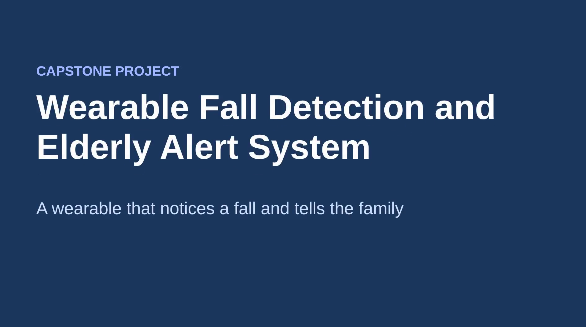
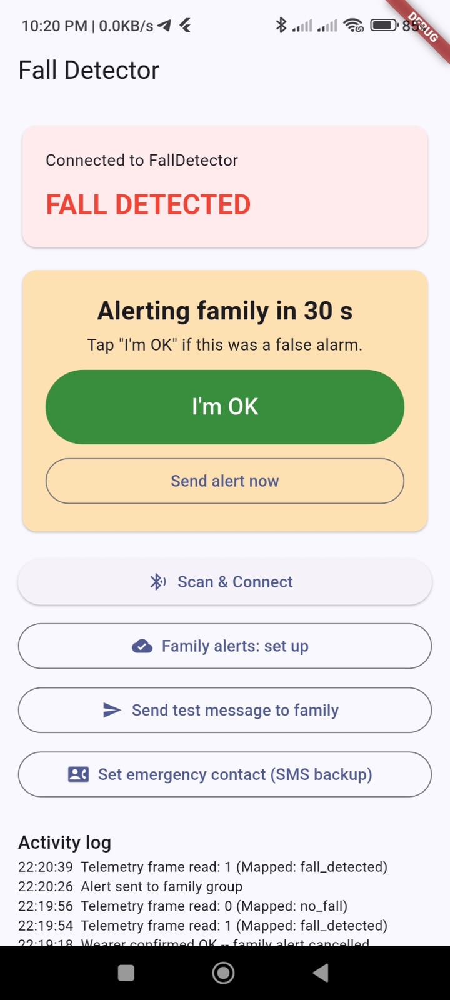
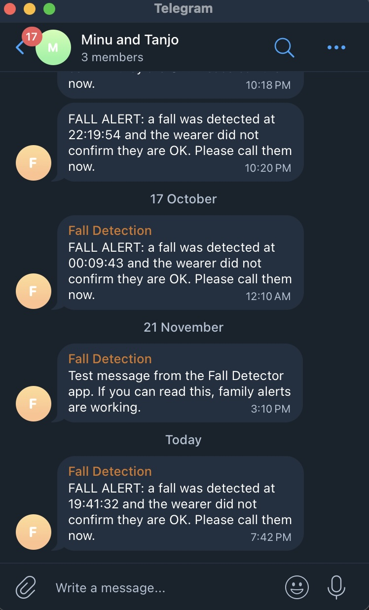

# Wearable Fall Detection and Elderly Alert System

A low-cost wearable that detects a fall on the device itself, asks the wearer "Are you OK?" for 30 seconds, and alerts the family through a Telegram group if there is no answer.

**Capstone Project** - Group 3
[](docs/assets/how_it_works.mp4)

> Click the picture to watch the 67-second explainer video. The project page is in [`docs/`](docs/index.html) (see "Project web page" below).

## The problem

Elderly people who live alone can fall and lie unnoticed for hours. Call buttons need the person to press them, and cameras are costly and invade privacy. This system uses a small waist-worn sensor and an AI model that runs on the device, so it needs no camera and keeps raw motion data private.

## How it works

1. **Wearable (ESP32 + MPU6050)** reads acceleration and rotation 100 times per second, clipped to a belt at the waist.
2. **TinyML model on the device** looks at the last 2.5 seconds every second and outputs fall / no_fall probabilities. A fall is confirmed when the fall probability is above 0.6 in 2 consecutive windows.
3. **Bluetooth Low Energy** sends the alert to the Android app (BLE server `FallDetector`).
4. **Android app (Flutter)** shows FALL DETECTED and a 30-second "Are you OK?" countdown. The wearer taps **I'm OK** to cancel.
5. **Telegram bot** sends the alert to the family group. If there is no internet, the message is queued and retried every 20 seconds.
6. **WiFi OTA** lets the firmware be updated wirelessly after the first USB upload.

| | |
|---|---|
|  |  |
| App: FALL DETECTED and 30 s countdown | Telegram group: alert messages |

## Results

Trained in Edge Impulse on the public [SisFall](https://doi.org/10.3390/s17010198) dataset (38 subjects, waist-worn). Windows were 2.5 s with a 1 s stride at 100 Hz, and the train/test split was **by subject** (31 training subjects, 7 unseen test subjects).

| Metric (six-axis model, deployed) | Value |
|---|---|
| Validation accuracy | 99.2% |
| Test accuracy (7 unseen subjects) | 98.57% |
| Fall recall | 97.5% |
| No-fall recall | 99.1% |
| RAM (Edge Impulse estimate) | about 7 KB |

The test figures were measured on the float32 version of the model; the exported model is int8-quantised. Screenshots are in [`ml/screenshots`](ml/screenshots).

## Honest limitations

- Validated on a public dataset (simulated falls) and bench tests; **not yet tested on elderly users in the field**.
- When the app is in the background, the Telegram alert is still sent, but the countdown pop-up is not shown, so a false alarm cannot be cancelled in that case. A foreground service is planned.
- Battery life has not been measured. SMS backup is not implemented.

## Repository structure

```
firmware/    ESP32 sketch: sensing, on-device inference, BLE alert, WiFi OTA
app/         Flutter Android app: BLE, countdown, Telegram alerts, offline queue
ml/          Dataset preparation scripts and Edge Impulse screenshots
hardware/    Layout of the parts inside the enclosure
report/      Final project report (PDF)
poster/      Project poster
docs/        Project web page (GitHub Pages) and media
```

## Hardware

| Part | Role |
|---|---|
| ESP32 development board | Runs the model, BLE and WiFi |
| MPU6050 module | 3-axis accelerometer + 3-axis gyroscope (I2C: SDA = GPIO 21, SCL = GPIO 22) |
| Battery and 5 V supply | Powers the ESP32 (see `hardware/`) |
| Enclosure | Clipped to a belt at the waist |

## Getting started

**1. Firmware**
1. Install the ESP32 board package in the Arduino IDE.
2. Add the Edge Impulse Arduino library exported from your project (the sketch includes `Wearable_Fall_Detection_inferencing.h`).
3. Open `firmware/esp32_fall_wearable_ble_ota.ino`, set `WIFI_SSID` and `WIFI_PASSWORD`, and upload over USB.
4. Later updates can be sent wirelessly: Tools, Port, `fall-detector-esp32`.

**2. Android app**
```bash
cd app
flutter create .      # generates the android/ folder once
flutter pub get
flutter run
```
Grant Bluetooth and notification permissions, connect to `FallDetector`, then enter your Telegram bot token and group chat ID in the app and tap **Send test message to family**.

**3. Telegram**
Create a bot with BotFather, add it to the family group, and note the group chat ID. **Never commit the bot token to this repository.**

**4. Model training (optional)**
Download SisFall, then run `ml/scripts/prepare_sisfall.py`, `balance_dataset.py` and `split_dataset.py` in this order. Upload the windows to Edge Impulse with the CSV Wizard shown in `ml/screenshots`.

## Project web page

The page in `docs/index.html` is ready for GitHub Pages: repository **Settings, Pages, Source: Deploy from a branch, Branch: `main`, Folder: `/docs`**. The site will appear at `https://<organisation-or-user>.github.io/<repository-name>/`.

## Team

- Tanjo Akter
- Monisha Das
- Samira Oasela Antika

**Supervisor:** Professor Md. Rokan Uddin Faruqui, Department of Computer Science and Engineering, University of Chittagong

## License

MIT License. The SisFall dataset is not included; follow its own terms of use.
